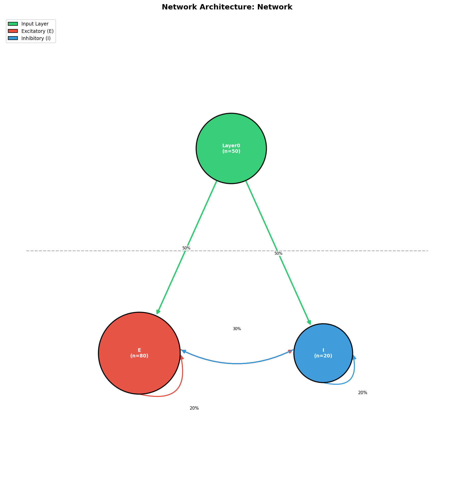
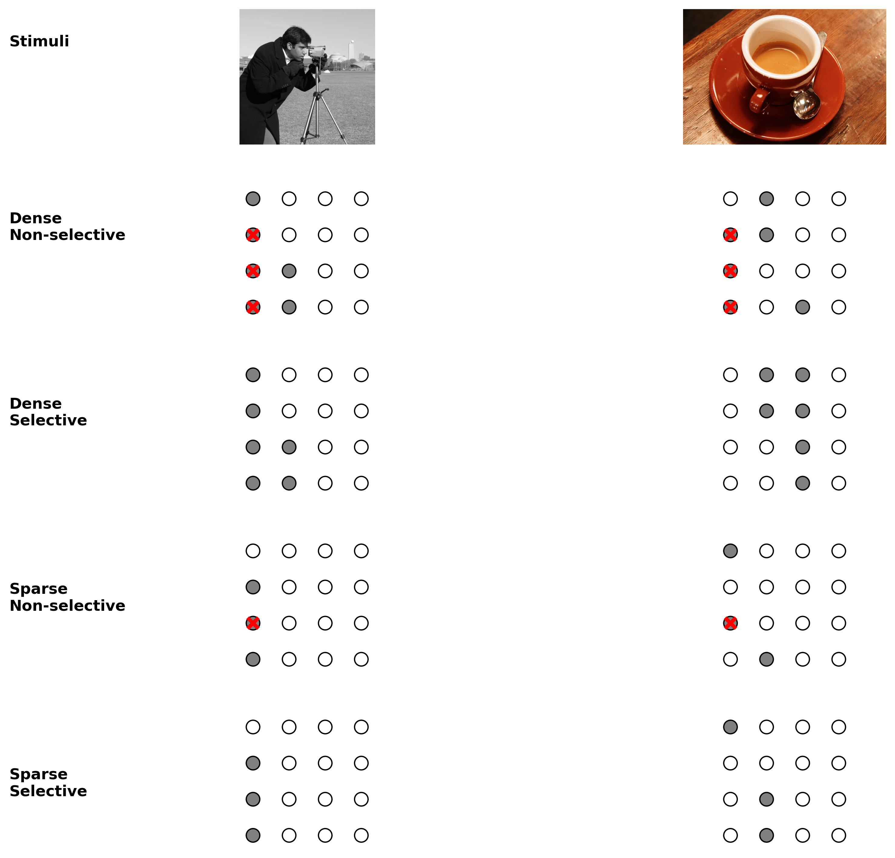
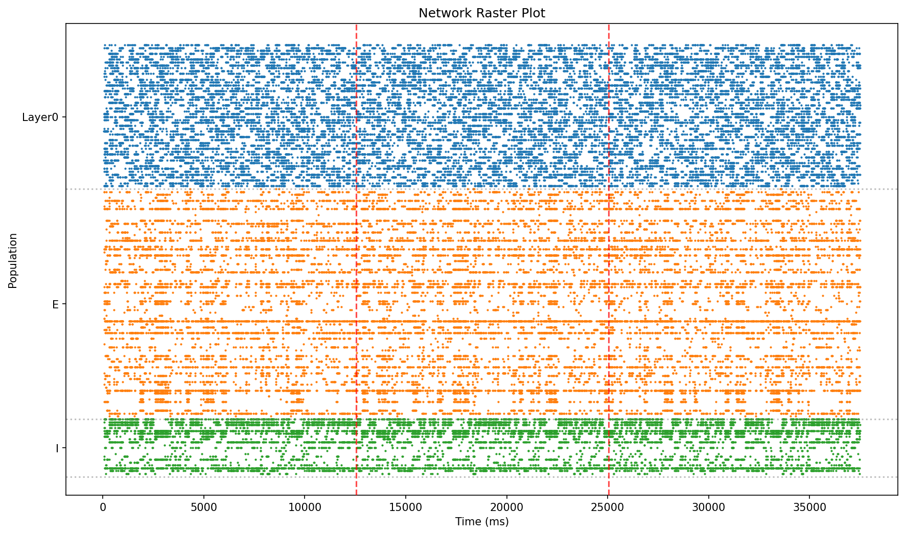
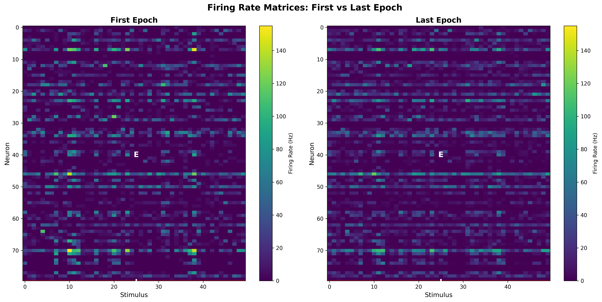
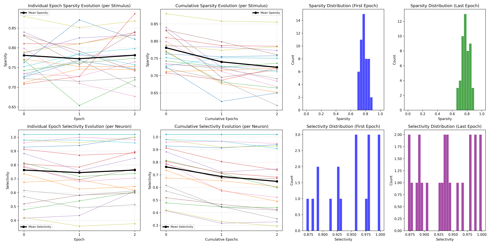
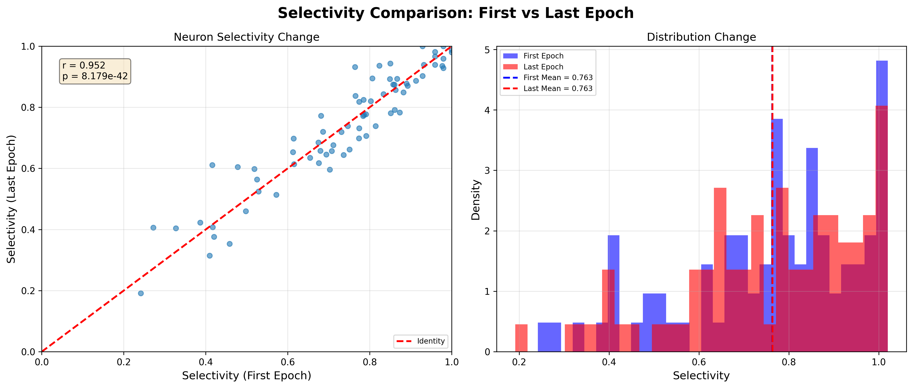
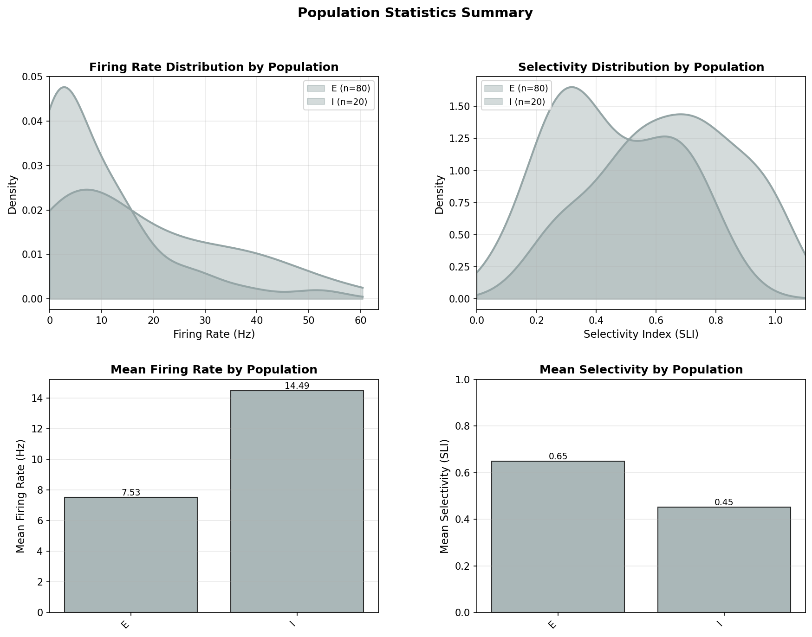

# SSBrian: stimulus selectivity and sparseness in random spiking networks

Toviah Moldwin and Maor Nativ. Idan Segev lab, Edmond and Lily Safra Center for Brain Sciences, Hebrew University of Jerusalem.

## Question

Neurons in sensory and medial temporal lobe circuits are often **selective**: each one responds to only a few stimuli. Population codes are often **sparse**: each stimulus activates only a few neurons. Work from Haim Sompolinsky's group argues that both properties can arise in randomly connected networks without any learning.

This repository tests that claim in spiking networks built with [Brian2](https://brian2.readthedocs.io). Excitatory and inhibitory leaky integrate-and-fire populations are randomly connected and driven by a Poisson input layer. Each stimulus is a fixed pattern of input firing rates, and the same stimuli are presented over and over with fresh Poisson noise. We ask two questions:

1. Do selective, sparse responses emerge?
2. Are they **stable** across repeated noisy presentations, or just an artifact of a single trial?

**Result:** yes on both counts. In the baseline random E/I network:

- E neurons have high selectivity (mean SLI 0.76 in the first epoch) and stimuli evoke sparse responses (mean sparseness 0.78).
- Each neuron's selectivity is largely preserved across repeated noisy presentations (r = 0.95, first epoch vs. last).
- Measured on the last epoch alone, mean selectivity falls somewhat, to 0.65, and sparseness to 0.72. The ranking of neurons stays the same.

A fresh run of `motif_baseline` reproduces these numbers and figures exactly.

## Model

The main model is `brian_experiment/cell_type_network/`. The populations, connections and stimulus protocol are all set in JSON files under `configs/runs/`.

- **Neurons:** leaky integrate-and-fire with current-based synapses that decay exponentially (τ_m = 20 ms, τ_syn = 1 ms, V_rest = −65 mV, V_th = −55 mV, 2 ms refractory period).
- **Input layer:** Poisson neurons. Each stimulus is a fixed vector of input rates drawn from a Dirichlet distribution (α = 0.5), so a few inputs carry most of the drive.
- **Connectivity:** random connections with a set probability for each pair of populations and lognormal weights.
  - Weights are scaled by 1/√k (k = number of inputs), with a separate gain for inhibition.
  - Motif-constrained connectivity is optional, for example extra reciprocal E–I pairs (`shared/core/motif_connectivity.py`).
  - Multi-layer feed-forward architectures are also supported.
- **Protocol:** 50 stimuli of 200 ms each, with 50 ms gaps, repeated over several epochs.

Baseline network (`motif_baseline.json`): 50 inputs → 80 E + 20 I recurrent neurons.



## Measures

`brian_experiment/shared/analysis/sparsity_and_selectivity.py` computes both measures on the neuron × stimulus firing-rate matrix.

- **Selectivity index (SLI):** per neuron, across stimuli.
- **Sparseness index:** per stimulus, across neurons.

Both use the normalized index S = (1 − (mean r)² / mean(r²)) / (1 − 1/N), which runs from 0 to 1. A value of 0 means every response is the same; a value of 1 means a single stimulus drives the neuron (or a single neuron responds to the stimulus).

`shared/analysis/temporal_evolution.py` recomputes the rate matrix and both indices for each epoch and cumulatively across epochs. It then compares each neuron's selectivity in the first and last epochs.



## Results (baseline run)

**Activity.** Spike raster of the input layer and the E and I populations over three epochs of 50 stimuli.


**Firing-rate matrices.** E neurons × stimuli. The pattern in the first epoch is repeated in the last.


**Sparseness and selectivity across epochs.** Per-stimulus sparseness and per-neuron selectivity, for each epoch and cumulatively, with distributions for the first and last epochs.


**Stability.** Selectivity of each E neuron in the first vs. last epoch.


**Population summary.** Firing-rate and selectivity distributions for the E and I populations.


`Runs/single_runs/` has the full set of figures for every run: voltage and current traces, Fano factors, exemplar neurons and motif statistics. This includes a network with extra reciprocal E–I connections (`motif_EI_reciprocal`) and the multi-layer variants (`test_two_layers*`, `three_layer*`).

## Running

```bash
pip install -r requirements.txt
python -m brian_experiment.cell_type_network.single_run --config motif_baseline
```

Run it from the repository root. The output goes to `brian_experiment/cell_type_network/Runs/single_runs/<config>/latest/`, including `Figures/`, `config.json` and `run_parameters.txt`. Use `--config test_quick_run` for a short smoke test.

## Repository layout

| Path | Contents |
|---|---|
| `brian_experiment/cell_type_network/` | Main model: E/I populations, layers and motifs set by JSON configs. Entry point `single_run.py` |
| `brian_experiment/shared/core/` | Stimuli, weight matrices, motif connectivity, spike analysis |
| `brian_experiment/shared/analysis/` | Selectivity and sparseness, temporal evolution, Fano factors, correlations, motif and ensemble analyses |
| `brian_experiment/shared/plotting/` | Figure generation |
| `brian_experiment/feedforward/` | Feed-forward version, with plasticity experiments and parameter sweeps |
| `brian_experiment/recurrent/` | Balanced recurrent network with grid and random parameter searches |
| `brian_experiment/docs/` | Notes on the recurrent and direct-input networks and on parameter sweeps |
| `brian_experiment/tests/` | Tests for connectivity order, Dale's law, motifs and plasticity rules |
| `brian_experiment/old/` | First version (`haim_network.py`) |
| `networks_files/` | Earlier rate-based models in NumPy |
| `brian_files/` | Brian2 warm-up scripts |
| `Toviah experiments/`, `metric_relationships.py`, `Dirichlet_Scaling_experiments.py` | Side analyses: how the two indices relate, and input-scaling experiments |

## Reference

Sompolinsky and colleagues showed that stimulus selectivity can emerge in random networks without learning. This project builds on that result and on discussions with Haim Sompolinsky's group.
